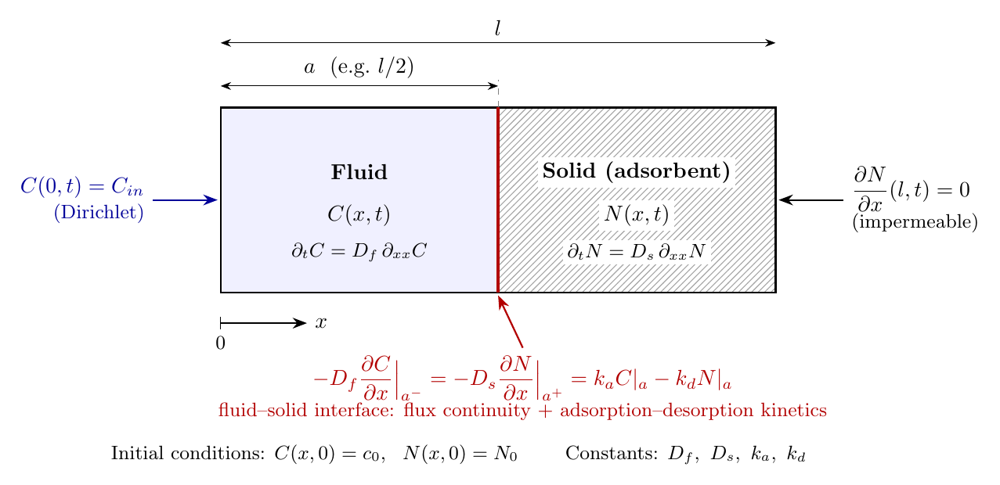

# Coupled adsorption benchmark

**Exact coupled benchmark for lattice Boltzmann (and other) simulations of adsorption**: transient
diffusion in a fluid layer and an adsorbent layer, coupled by first-order adsorption–desorption
kinetics at their interface.

[](https://github.com/pooriya1994/coupled-adsorption-benchmark/actions/workflows/tests.yml)

Developed at the **Applied Multi-phase Fluid Dynamics Laboratory**,
Iran University of Science and Technology (IUST), Tehran, Iran.

| Author | |
|---|---|
| **Pooriya Ghorbani** | AMFD Lab, IUST — p_ghorbani@mecheng.iust.ac.ir |

Pore-scale adsorption codes are usually verified with two decoupled tests: the Lévêque solution
for transport in the fluid, and diffusion into a particle for the adsorbed phase. Neither test
exercises the coupling between the fluid concentration, the interfacial kinetics and diffusion in
the solid. This repository gives the exact solution of the simplest problem in which all three
interact, together with tools for comparing any numerical solver with it.



## The problem

$$\frac{\partial C}{\partial t}=D_f\frac{\partial^2 C}{\partial x^2}\quad(0<x<a),\qquad
\frac{\partial N}{\partial t}=D_s\frac{\partial^2 N}{\partial x^2}\quad(a<x<l),$$

$$C(0,t)=C_{in},\qquad \frac{\partial N}{\partial x}(l,t)=0,\qquad C(x,0)=c_0,\quad N(x,0)=N_0,$$

$$-D_f\frac{\partial C}{\partial x}\bigg|_{a^-}=-D_s\frac{\partial N}{\partial x}\bigg|_{a^+}=k_a\,C(a,t)-k_d\,N(a,t).$$

$C$ and $N$ are amounts per unit volume of their own phase, so $k_a$ and $k_d$ are surface rate
constants. With $\xi=x/l$, $\tau=D_ft/l^2$, $\theta=C/C_{in}$ and $\phi=N/(KC_{in})$ the solution
depends on four groups and the initial state:

| Group | Definition | Meaning |
|---|---|---|
| $\alpha$ | $a/l$ | fluid fraction |
| $\gamma$ | $D_s/D_f$ | diffusivity ratio |
| $K$ | $k_a/k_d$ | Henry constant |
| $Da$ | $k_a l/D_f$ | Damköhler number |
| $\theta_0,\ \phi_0$ | $c_0/C_{in},\ N_0/(KC_{in})$ | initial state |

The package contains:

- `Benchmark`: the exact eigenfunction-series solution. Its eigenfunctions are orthogonal in a
  capacity-weighted inner product, and the series converges exponentially for $\tau>0$.
- `LaplaceSolution`: an independent exact form in the Laplace domain (kinetic, fluid-side and
  solid-side resistances in series), inverted numerically with Talbot's method.
- `fv_reference`: a second-order finite-volume solver, which also handles Langmuir kinetics.
- `PhysicalBenchmark`: the exact solution in physical or lattice units.
- `ldf_time`: the linear-driving-force time scale derived from the exact solution.

## Installation

```bash
git clone https://github.com/pooriya1994/coupled-adsorption-benchmark.git
cd coupled-adsorption-benchmark
pip install -e .          # add ".[plot]" for the figure scripts and ".[test]" for the tests
```

Requires Python 3.9 or newer with NumPy, SciPy and mpmath.

## Quick start

```python
from adsorption_benchmark import Benchmark

b = Benchmark(alpha=0.5, gamma=0.1, K=2.0, Da=2.0)   # reference case of the paper
b.theta([0.25, 0.5], 1.0)          # fluid concentration C/C_in at tau = 1
b.phi([0.5, 0.75, 1.0], 1.0)       # adsorbed loading N/(K C_in)
b.phi_mean([0.2, 1.0, 3.0])        # uptake curve (mean solid loading)
b.flux(1.0)                        # interfacial rate J* = J l/(D_f C_in)
b.interface_jump(1.0)              # theta(alpha-) - phi(alpha+) = J*/Da
b.eigenvalues[:6]                  # 0.718367, 2.270657, 3.607149, ...
```

### Physical or lattice units

```python
from adsorption_benchmark import PhysicalBenchmark

# Lattice units of a 2D LB run (dx = dt = 1): l = 99.5, D_f = 0.2, gamma = 0.1, K = 2, Da = 2
ka = 2 * 0.2 / 99.5
lb = PhysicalBenchmark(Df=0.2, Ds=0.02, ka=ka, kd=ka / 2, a=49.5, l=99.5, C_in=1.0)
t = lb.time(1.0)                   # number of time steps to reach tau = 1
lb.C([0.0, 25.0, 49.5], t)         # fluid concentration
lb.N([49.5, 75.0, 99.5], t)        # adsorbed loading
lb.mean_loading(t), lb.flux(t)
```

`C_in = 0` (desorption into a clean stream) is also supported.

## Command line: reference files for codes in any language

```bash
adsorption-benchmark table                                   # Table 2 of the paper
adsorption-benchmark eigen -n 20 --alpha 0.4 --gamma 1 --K 5 --Da 10
adsorption-benchmark profile --tau 0.05 0.2 1 3 --nodes 101 --out profiles.csv
adsorption-benchmark profile --tau 1 --xi-file my_nodes.txt --out exact_at_my_nodes.csv
adsorption-benchmark uptake --tau-max 3 --n 301 --out uptake.csv
```

Every command accepts `--alpha --gamma --K --Da --theta0 --phi0` (the defaults are the reference
case). The number of series terms is chosen automatically from the smallest $\tau$ requested.
`--xi-file` takes one $\xi=x/l$ per line, for example the node positions of your lattice.

## Reference values

These are for the reference case $\alpha=0.5$, $\gamma=0.1$, $K=2$, $Da=2$, $\theta_0=\phi_0=0$
(Tables 1 and 2 of the paper). The first eigenvalues are 0.718367, 2.270657, 3.607149, 4.573110,
6.257725 and 8.128313.

| $\tau$ | $\theta(0.25)$ | $\theta(0.5)$ | $\phi(0.5)$ | $\phi(0.75)$ | $\phi(1)$ | $\bar\phi$ | $J^*$ |
|---|---|---|---|---|---|---|---|
| 0.05 | 0.441899 | 0.190341 | 0.059053 | 1.4720e-5 | 2.2039e-11 | 0.004671 | 0.262577 |
| 0.2 | 0.782485 | 0.615198 | 0.351795 | 0.028256 | 0.001150 | 0.074939 | 0.526807 |
| 1 | 0.916674 | 0.836290 | 0.680351 | 0.364672 | 0.249708 | 0.398515 | 0.311878 |
| 3 | 0.970644 | 0.942233 | 0.886972 | 0.773869 | 0.731762 | 0.785830 | 0.110523 |

$\theta(0.5)$ is the fluid-side and $\phi(0.5)$ the solid-side interface value. Their difference
is the kinetic jump $J^*/Da$.

Full-precision files are in `data/`:

- `eigenvalues.csv`: the first 50 eigenvalues.
- `reference_values.csv`: the table above.
- `reference_profiles.csv`: $\theta$ and $\phi$ on 101 points per layer at $\tau$ = 0.05, 0.2, 1 and 3.
- `reference_uptake.csv`: $\bar\phi$, $J^*$ and the interface jump for $\tau$ = 0.01 to 3.

## Verifying a numerical code

1. **Domain.** Use an $n_x\times n_y$ lattice with small $n_y$ (e.g. 4), periodic in $y$, so that
   the solution is one-dimensional.
2. **Boundaries.** Impose $C=C_{in}$ at $x=0$ and zero flux of $N$ at $x=l$. The positions of these
   boundaries and of the interface define $l$ and $a$ in lattice units.
3. **Interface.** Implement the interface treatment you want to test.
4. **Parameters.** Set $D_s=\gamma D_f$, $k_a=Da\,D_f/l$ and $k_d=k_a/K$, and convert time with
   $\tau=D_ft/l^2$. Keep $D_f$ fixed while refining the grid (diffusive scaling).
5. **Comparison.** Compare the profiles, $\bar\phi(\tau)$, $J^*(\tau)$ and the interface values.
   Report the root-mean-square node error for several resolutions and the observed order of
   convergence (`Benchmark.error_norms` and `examples/verify_a_solver.py`).
6. **Optional checks.**
   - A flow along the interface, $\mathbf u=(0,u_y(x))$, must leave the solution unchanged.
   - With Langmuir kinetics at $\sigma=k_aC_{in}/k_d=0.01$, the uptake should deviate from the
     linear solution by about 0.26%. Use `fv_reference(sigma=...)` as the nonlinear reference.

In the paper, this protocol was applied to a Palabos code. With the interfacial flux imposed on
the populations that cross the interface, the LB solution converged at second order. With a
volumetric-source treatment of the same kinetics, it converged only at first order. The LB code
itself is not part of this repository.

## Reproducing the paper

| Script | Reproduces |
|---|---|
| `reproducibility/make_figures.py` | Figs. 2–6, plus the comparison with the finite-volume solver, its grid convergence, the mass balance and the Langmuir range of validity |
| `reproducibility/laplace_check.py` | Table 2 by Laplace inversion (agreement about $10^{-16}$) |
| `reproducibility/reference_data.py` | the files in `data/` |

## Tests

```bash
pip install -e ".[test]"
pytest
```

The tests cover:

- the eigenvalues and reference values against the paper;
- the governing equations, interface and boundary conditions, and the mass balance;
- agreement with the Laplace inversion;
- second-order convergence of the finite-volume solver;
- the physical-units wrapper and the command line.

## Citing

If you use this code, please cite the paper (see also `CITATION.cff`):

> P. Ghorbani, *An exact coupled benchmark for lattice Boltzmann simulation of adsorption:
> transient fluid–solid diffusion with interfacial adsorption–desorption kinetics*, in preparation (2026).

## License

MIT — see [LICENSE](LICENSE).
